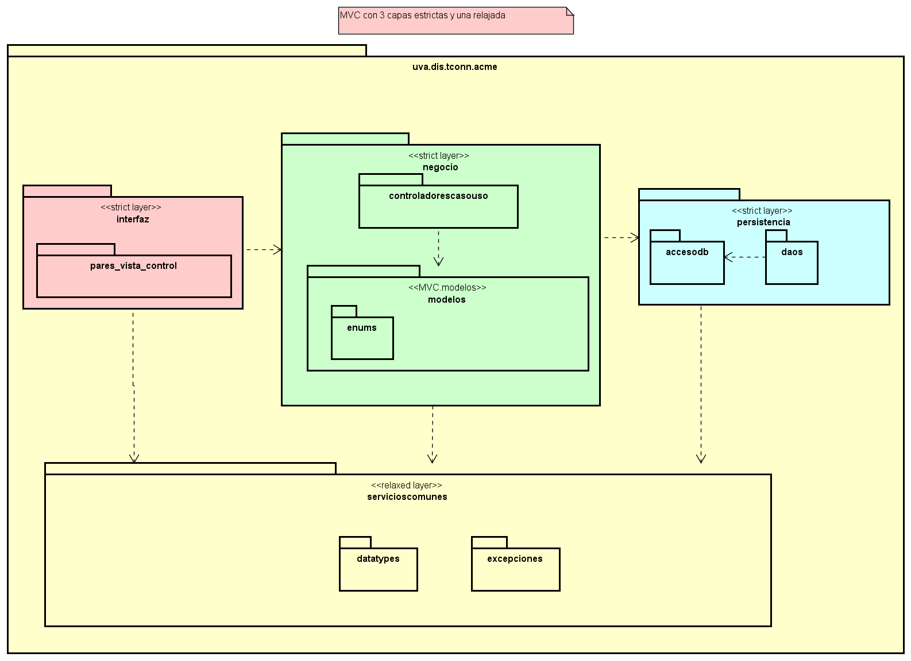

<div align="center">

# 📞 TCONN-ACME — Sistema de Gestión de Incidencias y Soporte Técnico

**Aplicación de escritorio en Java para la gestión integral de atención telefónica, control de disponibilidad de técnicos y seguimiento de incidencias en una empresa de telecomunicaciones, diseñada bajo arquitectura en capas y modelado UML.**


</div>

---

## Tabla de contenidos

- [📞 TCONN-ACME — Sistema de Gestión de Incidencias y Soporte Técnico](#-tconn-acme--sistema-de-gestión-de-incidencias-y-soporte-técnico)
  - [Tabla de contenidos](#tabla-de-contenidos)
  - [Descripción](#descripción)
  - [Casos de uso implementados](#casos-de-uso-implementados)
  - [Arquitectura y diseño](#arquitectura-y-diseño)
  - [Modelado UML](#modelado-uml)
  - [Base de datos y plan de pruebas](#base-de-datos-y-plan-de-pruebas)
  - [Tecnologías](#tecnologías)
  - [Estructura del proyecto](#estructura-del-proyecto)
  - [Instalación y ejecución](#instalación-y-ejecución)
    - [Requisitos](#requisitos)
    - [Pasos](#pasos)
  - [Equipo](#equipo)

---

## Descripción

**TCONN-ACME** implementa los subsistemas principales de soporte técnico y atención al cliente de una operadora de telecomunicaciones. El proyecto abarca desde el análisis y diseño orientado a objetos en **UML** hasta la implementación incremental en cuatro *releases* funcionales con interfaz gráfica de escritorio y persistencia relacional en **PostgreSQL**.

Proyecto desarrollado en equipo para la asignatura **Diseño de Sistemas Software (DIS)** del Grado en Ingeniería Informática en la Universidad de Valladolid (UVa).

## Casos de uso implementados

- **Identificar usuario (`IdentificarUsuarioControlador`):** Autenticación de empleados según su rol operativo (`Coordinador`, `Técnico`, `Supervisor`) y gestión de sesión activa (`Sesion`).
- **Cambiar disponibilidad de técnico (`CambiarDisponibilidadControlador`):** Actualización de estado operativo (`Disponible`, `Ocupado`, `En descanso`, etc.) con registro histórico de cambios de situación (`CambioDeSituacionTecnico`).
- **Consultar incidencias (`ConsultarIncidenciasControlador`):** Filtrado y visualización detallada de incidencias por estado, nivel de criticidad y técnico asignado para supervisión.
- **Atender llamada (`AtenderLlamadaControlador`):** Flujo completo de recepción de llamadas de clientes, validación de contratos, clasificación de llamadas (`LlamadaCorrecta`, `LlamadaIncorrecta`, `LlamadaInconsistente`), apertura de incidencias y asignación inteligente de técnicos disponibles por zona geográfica y turno.

## Arquitectura y diseño

El sistema sigue una **arquitectura en cuatro capas** con desacoplamiento entre interfaz, lógica de negocio y acceso a datos, aplicando patrones como **MVC (Pares Vista-Controlador)**, **Controlador de Caso de Uso**, **DAO** y **Value Objects / DataTypes**:



- **Interfaz (`uva.dis.tconn.acme.interfaz`):** Vistas en Java Swing (`AtenderLlamadaVista`, `CambiarDisponibilidadVista`, `ConsultarIncidenciasVista`, `IdentificarUsuarioVista`) coordinadas por `GestorVistas` y sus controladores de vista asociados.
- **Negocio (`uva.dis.tconn.acme.negocio`):** Controladores de caso de uso y jerarquía completa del dominio (`Empleado`, `Coordinador`, `Tecnico`, `Supervisor`, `Incidencia`, `Llamada`, `Contrato`, `TurnoTecnico`, `ZonaGeografica`).
- **Persistencia (`uva.dis.tconn.acme.persistencia`):** Acceso a PostgreSQL mediante JDBC (`ConexionDB`) y 8 clases DAO especializadas (`EmpleadoDAO`, `IncidenciaDAO`, `LlamadaDAO`, `ClienteDAO`, `ContratoDAO`, `TurnoTecnicoDAO`, `CambioDeSituacionDAO`, `ZonaGeograficaDAO`).
- **Servicios comunes (`uva.dis.tconn.acme.servicioscomunes`):** Tipos de datos validados (`Nif`, `IdEmpleado`, `IdContrato`, `CodigoIncidencia`, `CoordenadasGPS`, `Direccion`) y jerarquía de excepciones de negocio.

## Modelado UML

El repositorio incluye el proyecto completo de modelado en **Astah** (`models/TCONN-ACME.asta`) con los diagramas de casos de uso, diagramas de clases de análisis y diseño, diagramas de secuencia por caso de uso y diagramas de despliegue.

> *Consejo: Si exportas los diagramas principales desde Astah como imágenes `.png` a una carpeta `docs/diagramas/`, puedes mostrarlos directamente aquí en el README.*

## Base de datos y plan de pruebas

En la carpeta `app/db/` se incluyen tanto el esquema relacional como los juegos de datos preparados para validar cada caso de uso mediante pruebas de aceptación:

| Script SQL | Propósito |
|---|---|
| `createTablesActualizado.sql` | Creación completa de tablas, claves foráneas, restricciones e índices |
| `pruebas_cuIdentificarse.sql` | Escenarios de prueba de autenticación y roles de usuario |
| `pruebas_cuCambiarDisponibilidad.sql` | Escenarios de cambio de estado y turnos de técnicos |
| `pruebas_cuConsultarIncidencias.sql` | Datos de prueba para consultas y filtrado de incidencias |
| `pruebas_cuAtenderLlamada.sql` | Escenarios complejos de llamadas, contratos y asignación de técnicos |

## Tecnologías

| Capa | Tecnologías |
|---|---|
| Lenguaje | Java 17+ |
| Interfaz gráfica | Java Swing |
| Persistencia | PostgreSQL, JDBC (patrón DAO) |
| Modelado | UML (Astah) |
| Calidad y Build | Maven, SonarQube |

## Estructura del proyecto

```text
tconn-acme/
├── models/
│   └── TCONN-ACME.asta             # Modelos UML completos del sistema
├── app/
│   ├── db/                         # Esquema SQL y scripts de pruebas por caso de uso
│   └── netbeansProject/TCONN-ACME/
│       ├── src/main/java/uva/dis/tconn/acme/
│       │   ├── app/                # Punto de entrada (Main.java)
│       │   ├── interfaz/           # Vistas Swing y controladores de presentación
│       │   ├── negocio/            # Modelos de dominio y controladores de caso de uso
│       │   ├── persistencia/       # Conexión JDBC y DAOs
│       │   └── servicioscomunes/   # Sesión, DataTypes y excepciones
│       └── pom.xml
└── README.md
```

## Instalación y ejecución

### Requisitos

- JDK 17 o superior
- Maven 3.8 o superior
- PostgreSQL

### Pasos

1. **Clona el repositorio**

   ```bash
   git clone https://github.com/TU-USUARIO/tconn-acme.git
   cd tconn-acme
   ```

2. **Crea la base de datos y carga el esquema**

   ```bash
   psql -U postgres -c "CREATE DATABASE tconn_acme;"
   psql -U postgres -d tconn_acme -f app/db/createTablesActualizado.sql
   ```

3. **Configura la conexión:** Crea o edita el archivo `app/db/configdb.env` con tus credenciales locales de PostgreSQL.

4. **Compila y ejecuta la aplicación**

   ```bash
   cd app/netbeansProject/TCONN-ACME
   mvn clean package
   mvn exec:java -Dexec.mainClass="uva.dis.tconn.acme.app.Main"
   ```

## Equipo

Proyecto desarrollado por:

- **Elisa Martínez Lafuente** · [LinkedIn](https://www.linkedin.com/in/TU-PERFIL)
- **Ángel Antolín**
- **Marcos Gómez**

---

<sub>Proyecto académico · Diseño de Software · Grado en Ingeniería Informática · Universidad de Valladolid</sub>